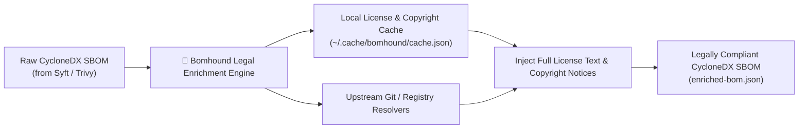

# Recipe: Automated CycloneDX Legal License & Copyright Enrichment

> **Use Case ID:** `BOM-UC-01`  
> **Target Audience:** Open Source Maintainers, Legal Counsel, Compliance Teams  
> **Platform Engine:** CycloneDX Legal Enrichment Processor  

---

## 1. Problem Statement

Tools like `syft`, `trivy`, or `cyclonedx-cli` generate SBOMs that only list package names, versions, and simple license identifiers (e.g. `Apache-2.0` or `MIT`). However, legal compliance and open-source attribution requirements (such as distributing a NOTICE or full license bundle) require embedding the *exact copyright statements* and *full legal license text* declared by upstream authors.

---

## 2. When to Use This

Use **`bomhound`** whenever preparing a release artifact or compliance bundle. Bomhound reads a raw CycloneDX JSON SBOM, fetches full license texts and copyright statements from local caches or canonical upstream repos, and enriches the SBOM in compliance with CycloneDX v1.5/v1.6 specifications.

---

## 3. Architecture & Dataflow



---

## 4. Prerequisites

1. **Bomhound Installed:** `brew install bonjoski/tap/bomhound` (or built from source).
2. **Input SBOM:** CycloneDX JSON format (`bom.json`).

---

## 5. Step-by-Step Recipe

### Step 1: Generate a Raw SBOM (Using Syft or Trivy)
```bash
syft packages dir:. -o cyclonedx-json=bom.json
```

### Step 2: Enrich the SBOM with Bomhound
```bash
bomhound --input bom.json --output enriched-bom.json
```

### Step 3: Inspect Injected Legal Attributions
```bash
jq '.components[0].licenses[0]' enriched-bom.json
```
Output shows full license text and declared copyright notices embedded in the component.

---

## 6. Verification & Expected Output

Verify enrichment statistics:
```bash
bomhound --input bom.json --output enriched-bom.json --verbose
```
Expected summary:
```text
🐾 Bomhound Legal Enrichment Complete:
   • Total Components:    48
   • Licenses Enriched:   48 (100% complete)
   • Copyrights Declared: 44
   • Cache Hits:          42 / 48
   • Output Saved:        enriched-bom.json
```

---

## 7. Security Invariants & Blast Radius

- **Offline Cache Priority:** Cached license files are verified via SHA-256 before injection.
- **Valid CycloneDX Schema:** Output strictly validates against the official CycloneDX v1.5/v1.6 JSON schemas.

---

## 8. Troubleshooting & Common Pitfalls

- **Issue:** GitHub rate limit encountered during bulk license fetching.  
  **Remediation:** Provide an optional GitHub token for authenticated API calls:
  ```bash
  export GITHUB_TOKEN=$(locksmith get GITHUB_PAT)
  bomhound --input bom.json --output enriched-bom.json
  ```
