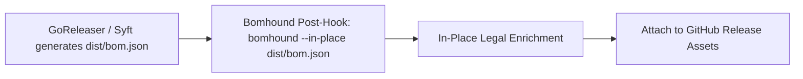

# Recipe: GitHub Actions CI/CD Release Enrichment Pipeline

> **Use Case ID:** `BOM-UC-03`  
> **Target Audience:** DevOps Engineers, Release Automation Teams  
> **Platform Engine:** In-Place File Overwrite & GitHub Action Wrapper  

---

## 1. Problem Statement

Release automation tools like GoReleaser or custom GitHub Actions workflows generate release archives and attach SBOMs to GitHub Releases. Adding a multi-step enrichment process that requires creating new temporary files complicates CI/CD scripts and leads to broken release links.

---

## 2. When to Use This

Use **Bomhound In-Place Enrichment (`--in-place`)** inside GitHub Actions or GoReleaser hooks. Bomhound modifies the generated SBOM in-place without altering file names, seamlessly slotting into existing release pipelines.

---

## 3. Architecture & Dataflow



---

## 4. Prerequisites

1. **GitHub Actions Workflow:** Triggered on tag or release.

---

## 5. Step-by-Step Recipe

### Step 1: Use Official Bomhound Action or CLI
In your `.github/workflows/release.yml`:
```yaml
name: Release

on:
  push:
    tags:
      - 'v*'

jobs:
  release:
    runs-on: ubuntu-latest
    steps:
      - uses: actions/checkout@v4

      - name: Generate Raw SBOM with Syft
        uses: anchore/sbom-action@v0
        with:
          format: 'cyclonedx-json'
          output-file: 'bom.json'

      - name: Install Bomhound
        run: |
          curl -fsSL https://raw.githubusercontent.com/bonjoski/bomhound/main/scripts/install.sh | bash

      - name: Enrich SBOM In-Place
        run: |
          bomhound --in-place bom.json

      - name: Upload Enriched Release Asset
        uses: softprops/action-gh-release@v1
        with:
          files: bom.json
```

---

## 6. Verification & Expected Output

The release workflow logs:
```text
🐾 Bomhound: Overwriting bom.json in-place with enriched legal metadata.
Asset uploaded: bom.json (48 components enriched).
```

---

## 7. Security Invariants & Blast Radius

- **Atomic File Write:** Writes to a temporary file (`.bom.json.tmp`) and renames atomically to prevent corrupted files if the runner terminates unexpectedly.

---

## 8. Troubleshooting & Common Pitfalls

- **Issue:** Runner lacks write permissions to output directory.  
  **Remediation:** Ensure runner user has write permissions to workspace.
